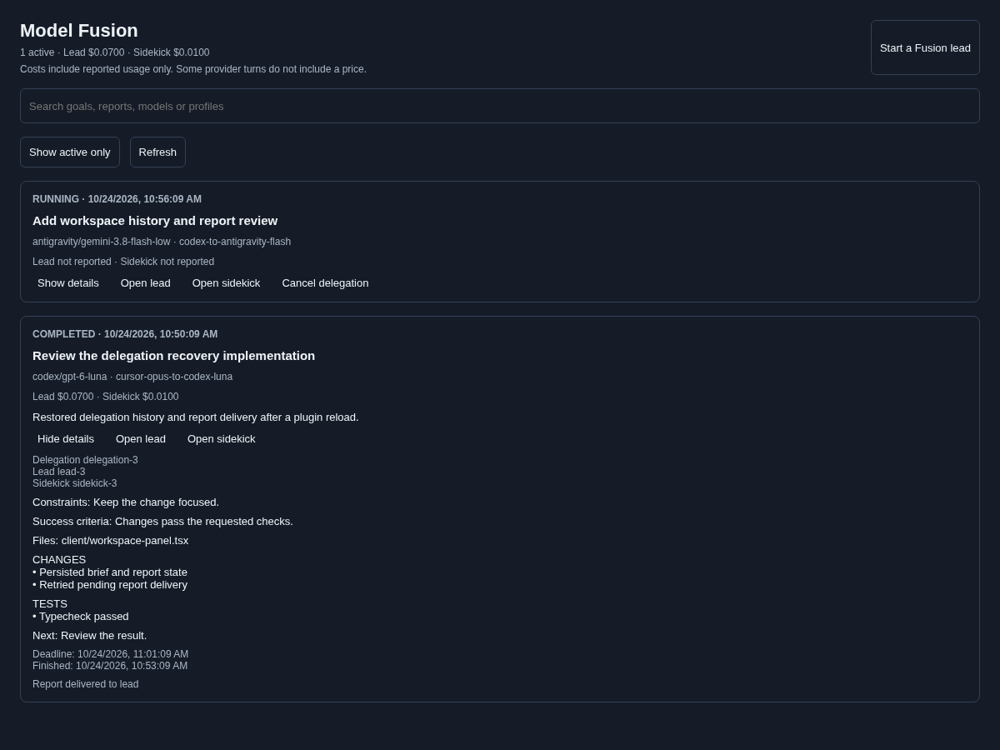

# Paseo Model Fusion

Pair a lead model with a cheaper implementation sidekick in Paseo. Each keeps its own conversation; they exchange a brief and a structured report. Inspired by [Cognition's Local Fusion](https://cognition.com/blog/local-fusion).

## Use it

Requires Paseo **0.13.0-beta.1 or newer** and authenticated providers for your chosen pair.

```bash
git clone https://github.com/sgoley/paseo-model-fusion.git
cd paseo-model-fusion
npm install
npm run typecheck
paseo plugin install "$PWD"
```

Open a workspace, then **Command Center → Open Model Fusion**. Choose **Start a Fusion lead**, select a pair, and enter the task. The lead plans, delegates, reviews the report, and can send follow-up briefs to the same sidekick.

The workspace panel shows active work and searchable, paginated history. Expand a delegation to read its constraints, success criteria, files, report, timestamps, and usage. Open either agent, cancel active work, or retry a saved report's delivery. Composer pills open this panel; timeline cards show each delegation's progress.

## Listing screenshots



[Model-pair selection and effort settings](assets/model-fusion-pairs.png). These screenshots use the real components with sample RPC data in the browser preview; native app chrome is not shown. Both images are declared in the plugin manifest and included in the package.

## Model pairs and effort

The first pair is the default for fresh settings. Existing saved defaults and customized profiles are preserved. The new-lead form shows each side's model and effort before starting.

| Profile ID | Lead | Sidekick | Effort: lead / sidekick |
| --- | --- | --- | --- |
| `codex-to-antigravity-flash` | Codex GPT-6.1 Sol | Antigravity Gemini 3.8 Flash | **High / Low** |
| `cursor-opus-to-codex-luna` | Cursor Claude Opus 5.5 | Codex GPT-6 Luna | **High / Medium** |
| `codex-to-omp-flash` | Codex GPT-6.1 Sol | OMP Gemini 3.8 Flash via Cursor | Provider defaults |
| `codex-sol-to-luna` | Codex GPT-6.1 Sol | Codex GPT-6 Luna | Provider defaults |
| `omp-sol-to-flash` | OMP GPT-6 Sol via Codex | OMP Gemini 3.8 Flash via Cursor | Provider defaults |
| `cursor-to-devin` | Cursor Grok 4.7 | Devin SWE 1.6 Slow | Provider defaults |
| `antigravity-argon-to-flash` | Antigravity Gemini 4 Argon Medium | Antigravity Gemini 3.8 Flash Low | Model variants |
| `claude-defaults` | Native Claude default | Native Claude default | Provider defaults; requires Claude login |
| `codex-gpt6luna-to-gpt61sol` | Codex GPT-6 Luna | Codex GPT-6.1 Sol | Existing compatible profile |

Flash Low uses AGY's `gemini-3.8-flash-low` model variant. Codex and Cursor effort is set with `thinkingOptionId`. All pairs can be customized in **Settings → Plugins → Model Fusion**: provider, model, mode, effort, brief detail, exploration, pushback, transport, timeout, and reuse limits.

## Delegation and provider compatibility

`auto` selects MCP for Codex and OMP, and fenced text for Cursor, Devin, and Antigravity. A Codex lead can use MCP while its AGY sidekick returns a fenced report. Leads started in fenced mode also use fenced reports for their sidekicks. Explicit `mcp` or `fenced` profiles are also available.

MCP uses a loopback HTTP endpoint with `delegate` and `report` tools. Reports require the delegation ID and a unique report token. Codex receives approval for only the relevant Fusion tool. Providers without an exact-tool preapproval capability use their regular permission flow. Cursor and Devin native MCP were verified with individual tool approvals; their automatic transport uses fenced text for unattended brief/report exchanges.

| Provider and tested model | Native MCP | Fenced brief/report |
| --- | --- | --- |
| Codex `gpt-6-luna` | Passed | Passed |
| OMP `cursor/gemini-3.8-flash` | Passed | Passed |
| Devin `swe-1-6-slow` | Passed with tool approvals | Passed |
| Cursor `grok-4.7` | Passed with tool approvals | Passed |
| Antigravity `gemini-3.8-flash-low` | Fusion tools unavailable through the current adapter | Passed |
| Native Claude | Awaiting CLI installation and authentication | Awaiting CLI installation and authentication |

These checks used real provider sessions on a1mini with Paseo 0.13.0-beta.1 on October 24, 2026. AGY authentication was also confirmed with a direct authenticated CLI response. Compatibility depends on the installed provider adapter, model access, and account. Cursor-hosted Opus uses Cursor authentication and does not require a native Claude login.

When MCP session startup is rejected, the plugin can create a labeled text-only successor with recent conversation context. This requires **Fallback to fenced**. A lead's fenced brief is processed once per turn; reports are validated against the current delegation.

For API-created leads, set `fusion.role=lead` and `fusion.profile=<profile-id>`, then supply delegation instructions. The panel supplies these labels and instructions automatically. Paseo's create hook does not expose labels, so the MCP endpoint is attached to non-internal sessions and checks the lead label when dispatching. If a provider supplies no caller ID and several leads are active, pass `lead_agent_id` explicitly.

## Persistence, limits, and costs

State is saved atomically under `$PASEO_HOME/plugin-data/paseo-model-fusion/state.json` (`~/.paseo` by default), with directory mode 700 and file mode 600. It includes briefs, reports, delivery receipts, deadlines, reuse state, and usage receipts. `PASEO_MODEL_FUSION_STATE_PATH` overrides the file location; `PASEO_MODEL_FUSION_PORT` overrides loopback port 31337. Use a separate state path and port for each runtime instance.

Reloads restore history and reconcile running sidekicks, elapsed deadlines, completed turns, and undelivered reports. Corrupt state is preserved in a `.corrupt-<timestamp>` file; unknown versions are left intact and prevent startup. History retention defaults to 30 days, configurable from 1 to 365; active work and undelivered reports are retained.

Report delivery is retried automatically and from the panel. A crash between sending a report and saving its receipt can cause redelivery; report IDs let the lead recognize duplicates. Timeline rows are refreshed from persisted state on recovery, while the workspace panel remains the complete history view.

Sidekicks are reused for the same lead and profile while idle, younger than 24 hours, and below the configured turn and reported-cost limits. These limits are checked between briefs; they do not impose a billing cap during a provider turn. A timeout or cancellation archives the affected sidekick, and late reports cannot overwrite that result. A turn without a valid report is marked blocked.

Costs include reported lead and sidekick usage, deduplicated by agent and turn. A lead turn with several briefs is split evenly across those delegations; subsequent review turns are assigned to its latest delegation. Reuse budgets include cumulative sidekick usage. Missing provider prices remain unknown and totals are marked partial. These are usage allocations, not invoice reconciliation.

## Settings

- **Enabled** controls creation and dispatch of new work.
- **Profiles / Default profile** choose and tune the model pair. Built-in presets remain available alongside custom profiles; matching custom IDs override them.
- **Use MCP delegation / Fallback to fenced** enable the transports. At least one must be enabled for new work.
- **Show composer pill / Show timeline card** control the agent UI contributions.
- **History retention days** controls completed history cleanup.

After changing plugin source, run `npm run typecheck` and `paseo plugin reload paseo-model-fusion`. Inspect `paseo plugin ls` and `paseo plugin logs paseo-model-fusion` for runtime status.

## Completed roadmap and outstanding work

- [x] Workspace panel with active work, history, search, pagination, details, navigation, cancellation, and delivery retry.
- [x] Durable delegation state and recovery across plugin reloads.
- [x] Real MCP and fenced protocol checks for Codex, OMP, Devin, and Cursor; authenticated AGY fenced checks.
- [x] Additional model pairs, including Sol/Flash and Cursor Opus/Codex Luna with explicit effort settings.
- [x] Lead and sidekick usage totals with partial-price handling.
- [x] Token-scoped reports, reusable sidekicks, timeout handling, and timeline/composer UI.
- [x] Listing screenshots packaged and declared in the manifest.

Outstanding validation:

- [ ] Run native Claude MCP and fenced checks after installing and authenticating its CLI on a1mini. Its profile and orchestration are implemented.
- [ ] Confirm the panel visually in the native Paseo desktop and mobile clients. Browser fixture checks cover its real components and actions, with a React Native HTML shim; they do not exercise the full native app shell.

No unimplemented feature remains from the original planned-feature list. AGY native MCP requires support from its provider adapter; fenced transport is available now.

## Development checks

```bash
npm run typecheck
npm test
# Real-provider checks: consume provider usage and archive their own probe sessions.
node scripts/provider-smoke.cjs omp
node scripts/provider-smoke.cjs antigravity fenced
node scripts/integration-smoke.cjs
# Fixture-only component preview:
npm run preview
```

Live scripts require the Paseo 0.13.0-beta.1 CLI and a running local daemon. Protocol results are recorded in `docs/provider-verification.json`; integration results in `docs/integration-verification.json`. The default integration check exercises the two preferred pairs, sidekick reuse, lead review, workspace isolation, token redaction, and history after reload. The preview serves synthetic data on localhost:31339, performs no real agent actions, and uses the installed CLI's bundler.

## Credits

[Cognition Local Fusion](https://cognition.com/blog/local-fusion), [paseo-continuity](https://github.com/keefeere/paseo-continuity), and [paseo-exporter](https://github.com/sgoley/paseo-exporter).
